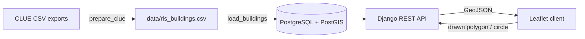

# Resident Information System (RIS)

**A web GIS that tells disaster responders which buildings are in an affected
area, how many people probably live there, and which of those buildings are
most vulnerable.**

Draw a polygon, rectangle or circle on the map and RIS returns the number of
buildings, dwellings and estimated residents inside it, broken down by a
construction-year-based vulnerability class, together with a priority list
of older residential buildings and a CSV export for field teams.


<!-- SCREENSHOT -->

---

## Background: a 2023 undergraduate project, rebuilt in 2026

RIS started in spring 2023 as the term project of **GMT 458 – Internet-Based
Geographic Information Systems** at Hacettepe University, Department of
Geomatics Engineering (Team 14: Mustafa Buğra Bekdemir and Alperen
Mollaahmet; supervisor Prof. Dr. Sultan Kocaman Gökçeoğlu).

### The problem we set out to solve

In earthquakes, floods and fires, the first hours are shaped by information.
Responders often lack reliable answers to basic questions: *How many people
live in this building? How old is it? How many people may be affected in this
neighbourhood?* Disinformation and missing data slow the response down. As
geomatics engineering students, we wanted to put building and resident
information on a map that anyone in the response chain can query.

The report defined two actors:

* **Rescue teams** select the affected neighbourhood, open a building and see
  its construction year, size and number of residents. That helps them
  estimate damage, plan the search and pass exact coordinates on to other
  teams.
* **Disaster victims** can look up their own building and send its exact
  location and likely occupancy to aid teams.

### What the 2023 version did

The authoritative Turkish sources for this kind of data (KBS, UAVT address
register, TKGM parcel queries) are not open, so we used the closest public
dataset we could find: the Kaggle *Melbourne Housing Market* data
(`melb_data.csv`). We cleaned it with **pandas**, stored it in
**SQLite → JSON → PostgreSQL**, served it with **Django**, and rendered the
map server-side with **Folium**. Users typed a suburb name and clicked
building markers to read a popup.

The 2023 code is archived unchanged (apart from removing credentials) in
[`legacy/2023-folium-version`](legacy/2023-folium-version).

### Why it was rebuilt

Looking back at the 2023 version, a few things limited it:

| Issue in 2023 | What it meant |
| --- | --- |
| "Residents" was the `Bedroom2` column renamed, assuming one person per bedroom | The core number of the app was not resident data |
| Records were property *sales* (2016-2017), not a building inventory | Coverage was arbitrary; only sold houses appeared |
| Only an exact, case-sensitive suburb filter | No way to describe the actual affected area |
| Folium HTML with ~6,000 markers was re-rendered on every request | Slow pages, no client-side interaction |
| Stamen tiles were discontinued in 2023 | One basemap stopped working |
| Credentials in `settings.py`, no requirements file, manual migration fixes | Hard to install or share |

### What changed in 2026

| | 2023 | 2026 |
| --- | --- | --- |
| Data | Kaggle housing sales, renamed bedroom count | City of Melbourne **CLUE** building census + residential dwelling counts (CC BY 4.0) |
| People estimate | bedroom count = people | dwellings × 1.8 people/household (ABS 2021 Census) |
| Selection | suburb name | **draw any polygon / rectangle / circle** + filters (area, year, floors, class, address) |
| Analysis | popup per building | totals, vulnerability breakdown, priority list, **CSV export** |
| Backend | Django + Folium (server-rendered map) | Django + **GeoDjango / PostGIS** + REST API (GeoJSON) |
| Frontend | Folium HTML | **Leaflet** client with Leaflet.draw, canvas rendering, legend, mobile layout |
| Operations | manual setup | **Docker Compose**, `.env` settings, automated tests + GitHub Actions |

---

## Data and method

### Sources

* **Building information** – City of Melbourne, Census of Land Use and
  Employment (CLUE): location, construction year, refurbishment year, floors
  above ground, predominant space use and accessibility for every building in
  the municipality.
* **Residential dwellings** – CLUE: number and type of dwellings per building
  (residential apartment, house/townhouse, student apartment).

Both are joined on census year and property ID. See
[`data/README.md`](data/README.md) for the full processing steps.

### Estimating residents

`estimated residents = dwellings × average household size`

The default household size is **1.8 people**, the 2021 ABS Census average for
the Melbourne City SA3. It is an average, so the estimate is reliable for
areas and less so for a single building. Change it with the `HOUSEHOLD_SIZE`
setting.

### Vulnerability classes (screening only)

The colour of each building is an *indicative* class based on its
construction year and the history of Australian earthquake design codes. It
does **not** replace an engineering assessment.

| Class | Built | Rationale |
| --- | --- | --- |
| High | before 1945 | era of unreinforced masonry, the most vulnerable building stock in Australia |
| Elevated | 1945-1979 | before the first Australian earthquake standard, AS 2121-1979 |
| Moderate | 1980-1994 | AS 2121-1979 era (limited zones) |
| Low | 1995 onwards | AS 1170.4-1993, referenced in the Building Code of Australia from 1995 |
| Unknown | – | construction year not recorded |

---

## Architecture



| Endpoint | Method | Description |
| --- | --- | --- |
| `/api/meta/` | GET | dataset summary, small areas, vulnerability legend |
| `/api/buildings/` | GET | GeoJSON of buildings; filters `small_area`, `year_min`, `year_max`, `floors_min`, `risk`, `residential`, `q`, `bbox` |
| `/api/area-stats/` | POST | totals, class breakdown and priority list inside `geometry` (GeoJSON Polygon/MultiPolygon or `{"type":"Circle","center":[lon,lat],"radius":m}`) |
| `/api/export/` | POST | CSV of the buildings inside `geometry` |

Example:

```bash
curl -X POST http://localhost:8000/api/area-stats/ \
  -H "Content-Type: application/json" \
  -d '{"geometry":{"type":"Circle","center":[144.9631,-37.8136],"radius":300},
       "filters":{"residential":true}}'
```

---

## Running it

### With Docker (recommended)

```bash
git clone https://github.com/MustafaBugraBEKDEMiR/residenceinsys.git
cd residenceinsys
docker compose up --build
```

Then open http://localhost:8000. On first start the container migrates the
database and loads `data/ris_buildings.csv`.

### Without Docker

Requirements: Python 3.11+, PostgreSQL with PostGIS, GDAL/GEOS
(on Windows the easiest route is [OSGeo4W](https://trac.osgeo.org/osgeo4w/);
then set `GDAL_LIBRARY_PATH` and `GEOS_LIBRARY_PATH` in `.env`).

```bash
python -m venv .venv && source .venv/bin/activate   # Windows: .venv\Scripts\activate
pip install -r requirements.txt
cp .env.example .env                                 # edit DATABASE_URL
python manage.py migrate
python manage.py load_buildings
python manage.py runserver
```

### Tests

```bash
pytest
```

The tests use small CLUE-format fixtures and cover parsing, cleaning, the join,
vulnerability classes and every API endpoint.

---

## Project structure

```
buildings/            Django app: model, CLUE processing, risk classes, API, tests
config/               Django settings and URLs
templates/, static/   Leaflet client (Leaflet + Leaflet.draw vendored for offline use)
data/                 processed dataset + how to rebuild it
docker/, Dockerfile   container setup
legacy/               the original 2023 Folium version
```

## Limitations and next steps

* Residents are an estimate from dwelling counts and an average household
  size. They are not a head count, and day/night occupancy is ignored.
* The vulnerability class only uses construction year. Structural system,
  soil class and retrofits are not in the data.
* Coverage is the City of Melbourne municipality only.
* **Adapting it to Turkey** is the original motivation. With access to the
  UAVT address register and building-level occupancy (or MAKS/e-Devlet data
  for authorised users), the same pipeline could serve AFAD-style response
  planning. Only the data loader would need to change.
* A mobile client with location sharing (from the 2023 report's future work).

## Credits

* 2023 version: Mustafa Buğra Bekdemir and Alperen Mollaahmet, Hacettepe
  University GMT 458, supervised by Prof. Dr. Sultan Kocaman Gökçeoğlu.
* 2026 rebuild: Mustafa Buğra Bekdemir.
* Data: City of Melbourne Open Data Portal (CLUE), CC BY 4.0; household size
  from the Australian Bureau of Statistics 2021 Census.
* Code licence: MIT.

---

### Türkçe özet

RIS, 2023 yılında Hacettepe Üniversitesi Geomatik Mühendisliği GMT 458
(İnternet Tabanlı CBS) dersi için geliştirdiğimiz bir afet bilgi sistemidir.
Amaç, afet bölgesine giden ekiplere bölgedeki binalar ve olası kişi sayısı
hakkında hızlı bilgi sağlamaktır. 2023 sürümünde açık veri bulamadığımız için
Kaggle'daki Melbourne konut satış verisini kullanmış ve oda sayısını kişi
sayısı kabul etmiştik. 2026 güncellemesinde proje, City of Melbourne'ın bina
bazındaki açık CLUE verisiyle yeniden yazıldı. Artık haritada herhangi bir
alan çizilerek o alandaki bina, konut ve tahmini kişi sayısı, yapım yılına
dayalı kırılganlık sınıfına göre özetleniyor ve CSV olarak indirilebiliyor.
